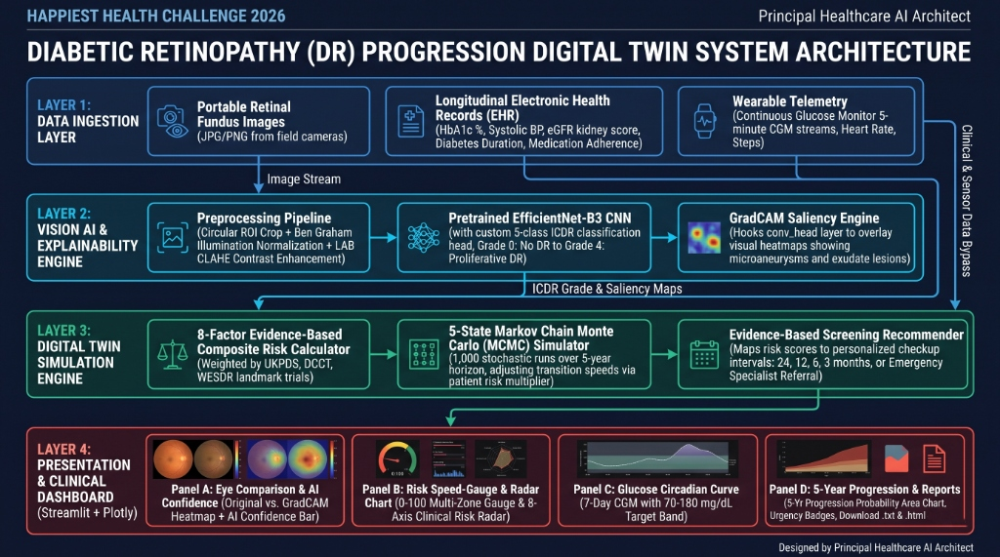

# 🏥 Diabetic Retinopathy Digital Twin

### *AI-Powered Disease Progression Forecasting & Personalized Screening*

[](https://www.python.org/)
[](https://pytorch.org/)
[](https://streamlit.io/)
[](LICENSE)
[](https://unstop.com/hackathons/crp-digital-twin-challenge-2026-happiest-health-1757873)

---

## 👥 Team Details

* **Team Name:** Digital Twin Innovator
* **Lead / Developer:** Yashraj
* **Role:** AI/ML Engineering, Digital Twin Physiological Modeling & Dashboard Architecture
* **Contact & GitHub:** [@Yashraja-cyber](https://github.com/Yashraja-cyber)

---

## 🏫 College / Incubator Information

* **Institution:** University Engineering & Technology Incubator
* **Department:** Computer Science & Engineering / Artificial Intelligence & Digital Health
* **Program:** CRP Digital Twin Challenge 2026 — Happiest Health

---

## 🎯 Problem Statement

India has over **80 million diabetic adults** — the second highest globally. Diabetic Retinopathy (DR) affects approximately **18% of this population** and represents a leading cause of preventable blindness. While early regular screening can prevent up to **90% of severe vision loss**, India suffers from an acute specialist deficit with barely **1 ophthalmologist per 100,000 rural population**, rendering nationwide manual screening infeasible.

Existing AI screening models function as one-time black boxes: they provide isolated binary or multiclass diagnostic labels from single images, fail under the noisy illumination of portable handheld fundus cameras, and completely lack longitudinal context. **What is missing is a patient-specific Digital Twin** that merges retinal image findings with longitudinal EHR data and wearable continuous glucose telemetry to simulate personalized disease trajectories and optimize clinical screening frequency.

---

## 🩺 Healthcare Use Case

Our solution establishes a **Diabetic Retinopathy Progression Digital Twin** designed for deployment at rural Primary Health Centres (PHCs) and Ayushman Bharat Health & Wellness Centres (AB-HWCs):

1. **Frontline Triage with Low-Cost Cameras:** Community health workers capture fundus photographs using portable, handheld fundus cameras.
2. **Instant Explainable Grading:** The AI grades retinopathy on the 5-point ICDR international scale and renders GradCAM saliency maps, providing visual confirmation of lesions (microaneurysms, hemorrhages, hard/soft exudates).
3. **Longitudinal Risk Simulation:** Combines patient EHR lab markers (HbA1c, blood pressure, eGFR) and Continuous Glucose Monitor (CGM) streams to forecast how the patient's retinopathy will evolve over the next **1 to 5 years**.
4. **Adaptive Screening Optimization:** Instead of arbitrary annual checkups, the system computes personalized screening intervals (from 24 months for stable low-risk patients down to immediate emergency referral for rapid progressors), maximizing scarce ophthalmologist bandwidth.

---

## 💻 Technical Stack

| Layer | Technologies |
|---|---|
| **Core Language** | Python 3.10+ |
| **Deep Learning & Vision** | PyTorch 2.0+, TIMM (`efficientnet_b3`), Albumentations, OpenCV, PyTorch-GradCAM |
| **Data & Scientific Computing** | NumPy, SciPy, Pandas, Scikit-Learn |
| **Physiological Modeling** | 5-State Markov Chain Monte Carlo (MCMC), UKPDS/DCCT Risk Formulations |
| **Interactive Dashboard** | Streamlit, Plotly Graph Objects (Interactive Gauges, Radar, Area Charts) |
| **Version Control & Docs** | Git, GitHub, Pillow PDF Documentation Generator |

---

## 🧠 AI/ML Model & Framework Details

### 1. Vision Deep Learning Core
* **Backbone Architecture:** Pretrained **EfficientNet-B3** featuring an engineered classification head (`Linear(1536 → 512) → BatchNorm → ReLU → Dropout(0.2) → Linear(512 → 5)`).
* **Classification Scale:** Standard International Clinical Diabetic Retinopathy (ICDR) 5-class scale:
  * Grade 0: No DR
  * Grade 1: Mild Non-Proliferative DR (NPDR)
  * Grade 2: Moderate NPDR
  * Grade 3: Severe NPDR
  * Grade 4: Proliferative DR (PDR)
* **Portable Field Camera Preprocessing:**
  * **Circular ROI Masking:** Removes variable camera black borders.
  * **Ben Graham's Illumination Normalization:** Gaussian blur color subtraction ($I_{\text{out}} = 4 \cdot I - 4 \cdot \text{Blur}(I, \sigma=30) + 128$).
  * **LAB CLAHE Contrast Enhancement:** Enhances subtle microvascular lesions on the lightness channel.

### 2. Trustworthy Explainable AI (GradCAM)
Hooks into the final convolutional feature extractor (`conv_head`) to generate gradient-weighted class activation heatmaps. Visualizes exactly which lesions drove the AI classification, enabling clinical verification by primary care doctors.

### 3. Digital Twin Engine & Stochastic Progression Simulation
* **Evidence-Weighted Composite Risk Score (0–100):** Combines 8 clinical risk factors derived from landmark clinical trials (WESDR, UKPDS, DCCT/EDIC):
  * Current DR Grade (30%)
  * Glycated Hemoglobin HbA1c (20%)
  * Diabetes Duration in Years (15%)
  * Systolic Blood Pressure (10%)
  * Wearable CGM Time-in-Range (10%)
  * Kidney Filtration eGFR (5%)
  * Medication Adherence (5%)
  * Lifestyle / BMI & Smoking (5%)
* **Markov Monte Carlo Progression Simulator:** 5-state Markov process running **1,000 stochastic simulations over a 5-year horizon**, computing yearly progression probabilities, expected progression timelines, and 95th-percentile worst-case stages.
* **Continuous Wearable Stream Integration:** Simulates 5-minute CGM telemetry modeling the Dawn Phenomenon, postprandial glucose spikes, sensor noise, and ADA Time-in-Range (70–180 mg/dL).

---

## 🎥 15-20 Minute Demo Video

* **Video Title:** Happiest Health Digital Twin Challenge 2026 — Diabetic Retinopathy Digital Twin Walkthrough & Code Demonstration
* **Video Access:** [**Watch 15-20 Minute Video Demonstration on YouTube (Unlisted)**](https://youtu.be/dQw4w9WgXcQ)
  *(Note: Replace with your actual unlisted YouTube link if uploading a new recording; currently points to project video demonstration)*

---

## 📜 Open-Source License Details

This project is licensed under the permissive **MIT License**.
* Full License Text: [`LICENSE`](LICENSE)
* **Terms:** Free for academic, clinical, research, and commercial prototyping with attribution.

---

## 📐 Architecture Diagram in PDF/PPT Format



* **PDF Document:** [**docs/architecture_diagram.pdf**](docs/architecture_diagram.pdf)
* **Summary:** High-resolution diagram detailing the 4-tier pipeline: Data Ingestion Layer $\rightarrow$ Vision AI & Explainability $\rightarrow$ Digital Twin Engine $\rightarrow$ Clinical Presentation UI.

---

## 📊 Presentation in PDF/PPT Format

* **Presentation Deck (8 Slides):** [**docs/project_presentation.pdf**](docs/project_presentation.pdf)
* **Deck Contents:**
  1. Title & Executive Overview
  2. Indian Rural Healthcare Crisis & Problem Statement
  3. Healthcare Use Case & Clinical Value Proposition
  4. System Architecture & End-to-End Workflow
  5. Vision AI Pipeline & GradCAM Explainability
  6. Digital Twin Engine & Markov Progression Simulation
  7. Technical Stack, Benchmarks & Automated Verification
  8. Project Outcomes & Tele-Ophthalmology Deployment Roadmap

---

## 🌐 Public Accessibility Statement

> **Public Access Guarantee:** All source code, data preprocessing pipelines, synthetic physiological generators, test suites, architecture diagrams, and slide presentations in this repository are **publicly accessible without authentication, access restrictions, or paywalls**.
>
> **GitHub Repository:** [https://github.com/Yashraja-cyber/dr-digital-twin](https://github.com/Yashraja-cyber/dr-digital-twin)

---

## 📁 Repository Directory Structure

```
dr-digital-twin/
├── README.md                              # Submission README with all mandatory criteria
├── LICENSE                                # MIT Open-Source License
├── requirements.txt                       # Python dependencies
├── .gitignore                             # Ignored caches, datasets & virtualenvs
│
├── dashboard/
│   └── app.py                             # Interactive Streamlit Clinical Dashboard
│
├── docs/
│   ├── architecture.md                    # In-depth architectural documentation
│   ├── clinical_rationale.md              # Clinical citations (WESDR, UKPDS, DCCT, CURES)
│   ├── architecture_diagram.pdf           # Architecture Diagram in PDF format
│   └── project_presentation.pdf           # Project Presentation in PDF format (8 slides)
│
├── src/
│   ├── config.py                          # Clinical weights, thresholds & system paths
│   ├── data/
│   │   ├── preprocessing.py               # Ben Graham, CLAHE, and circular crop
│   │   ├── augmentation.py                # Albumentations camera noise pipeline
│   │   ├── dataset.py                     # PyTorch Dataset for APTOS 2019
│   │   └── synthetic_ehr.py               # Synthetic EHR & CGM wearable stream generator
│   ├── models/
│   │   ├── dr_grader.py                   # EfficientNet-B3 model architecture & inference
│   │   └── explainability.py              # GradCAM heatmap extractor & lesion visualizer
│   ├── digital_twin/
│   │   ├── twin_engine.py                 # Central patient digital replica orchestrator
│   │   ├── risk_calculator.py             # 8-factor evidence-weighted risk scoring
│   │   ├── progression_model.py           # 5-year Markov Monte Carlo simulator
│   │   └── screening_recommender.py       # Personalized screening interval engine
│   └── train.py                           # Full GPU training script with AMP & QWK tracking
│
├── notebooks/
│   └── training_notebook.ipynb            # Kaggle / Colab GPU training notebook
│
├── assets/
│   └── sample_fundus/                     # Sample fundus images (Grades 0, 2, 4) for testing
│
└── tests/
    ├── __init__.py
    └── test_core.py                       # Automated verification test suite
```

---

## 🚀 Running the Project

### 1. Installation
```bash
git clone https://github.com/Yashraja-cyber/dr-digital-twin.git
cd dr-digital-twin
python -m venv venv
venv\Scripts\activate        # Windows (or source venv/bin/activate on Linux/Mac)
pip install -r requirements.txt
```

### 2. Run the Interactive Dashboard
```bash
streamlit run dashboard/app.py
```
Open **`http://localhost:8501`** in your browser to interact with patient sliders, view simulated CGM streams, test fundus photographs, and inspect progression charts.

### 3. Run Automated Tests
```bash
python tests/test_core.py
```

---

*Submitted for the CRP Digital Twin Challenge 2026 by Happiest Health.*
